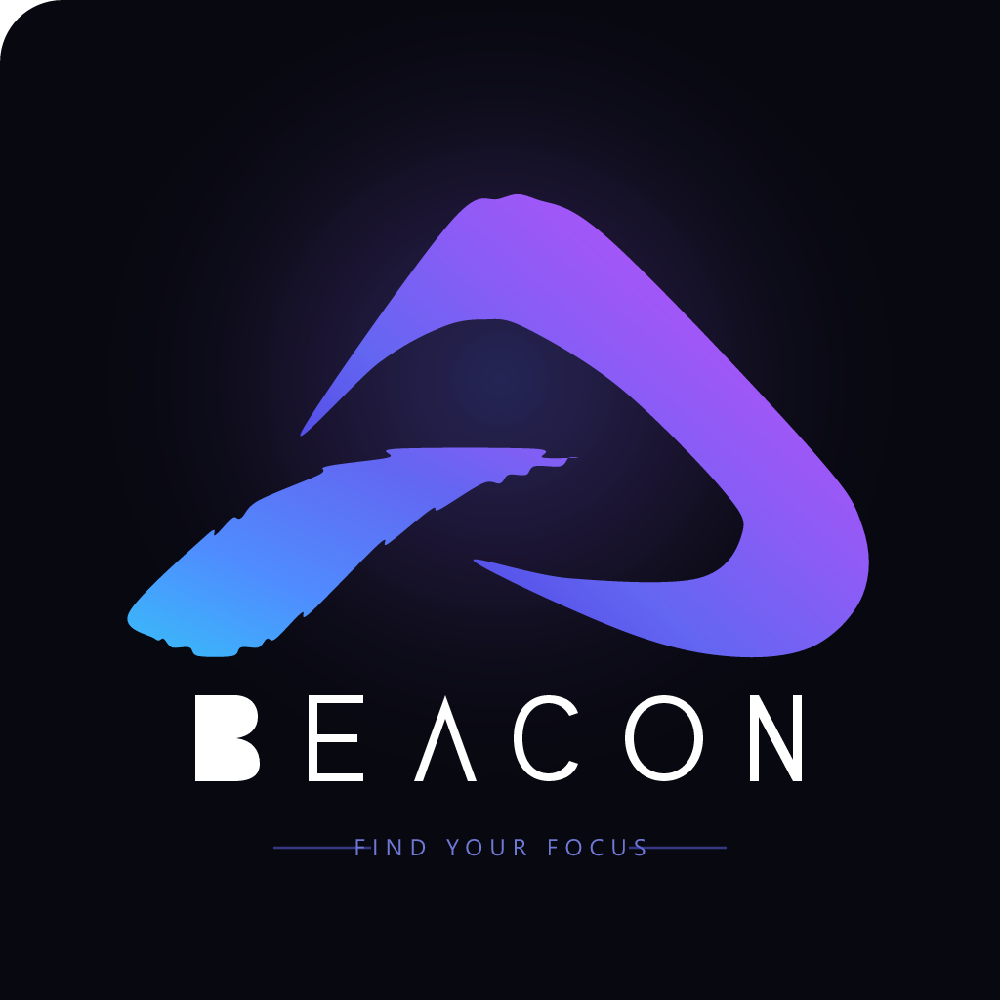
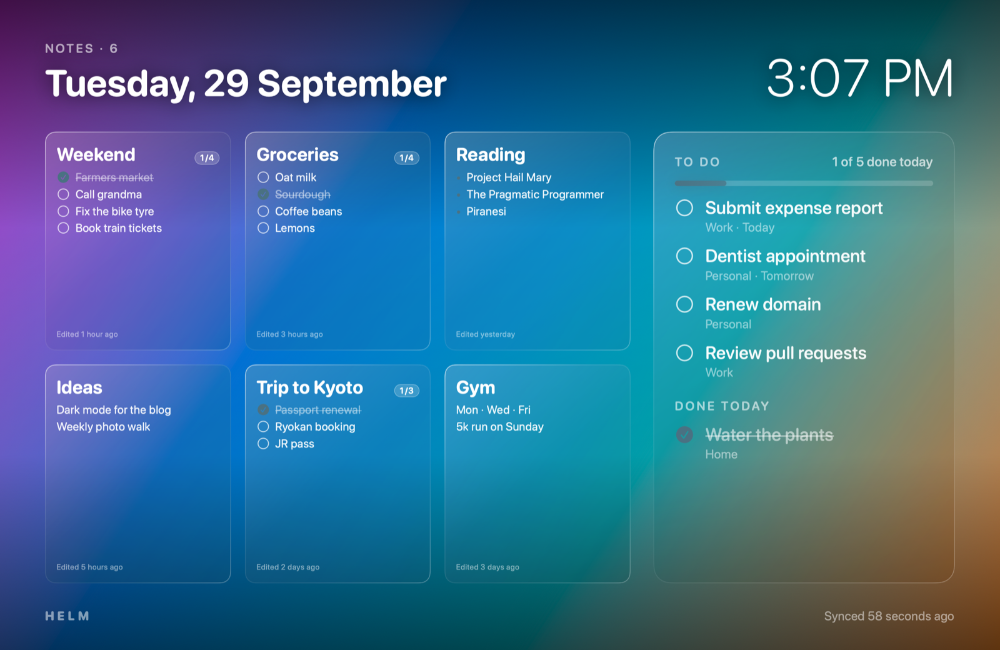

# BEACON

<p align="center">
  
</p>

> **Find Your Focus** — A calm, ambient productivity and live awareness desktop companion with native implementations for **Windows** and **macOS**, accompanied by a shared **Chromium browser extension** and an **OCR quotation extraction backend**.



---

## Monorepo Architecture

The repository is structured as an integrated monorepo with cleanly separated applications and shared components:

```text
Beacon/
├── apps/
│   ├── windows/          # Windows Desktop Application (Electron + React + TypeScript)
│   └── macos/            # Native macOS Application & Screensaver (Swift + AppKit)
├── services/
│   └── api/              # Python OCR & Quotation Extraction Backend (FastAPI + Tesseract)
├── extension/            # Shared Chromium Browser Extension (Chrome, Edge, Brave)
├── tests/
│   └── extension/       # Browser Extension Test Suite (Playwright + Node.js)
├── docs/                 # Documentation & media assets
├── .github/              # CI/CD Workflows
└── README.md             # Repository Documentation
```

---

## Applications & Services

### 1. Windows Application (`apps/windows/`)

A native-feeling Windows 10 & 11 companion desktop application:
- **Ambient Screen Board:** Hardware-accelerated Ken Burns photo slideshow, typography clock, localized weather, and quotes.
- **Notes & Tasks:** Local pure-WASM SQLite database (`sql.js`) with atomic file persistence.
- **Native Messaging Bridge:** Local Named Pipe IPC (`\\.\pipe\beacon-windows-ipc`) and custom windowless launcher (`beacon-native-host.exe`).
- **Screensaver:** Custom C# launcher (`Beacon.scr`) integrating directly into Windows screensaver subsystem.
- **Packaging:** Per-user NSIS installer created via electron-builder.

For detailed documentation, see [`apps/windows/README.md`](apps/windows/README.md).

```sh
cd apps/windows
npm install
npm run build
npm test
```

### 2. macOS Application (`apps/macos/`)

The original native macOS application:
- **Helm.app:** Menu bar application that manages synchronization, notifications, and settings.
- **Helm.saver:** Native macOS screensaver displaying notes and reminders over a photo slideshow.
- **Native Host:** macOS native messaging integration for Chromium browsers.

For building and packaging:

```sh
# Dependencies for macOS build
brew install tesseract
python3 -m venv services/api/.venv
services/api/.venv/bin/python -m pip install -r services/api/requirements-build.txt

# Build and install to ~/Applications and ~/Library/Screen Savers
cd apps/macos
./build.sh --install
```

### 3. OCR & Extraction Backend (`services/api/`)

A local Python service utilizing Tesseract OCR to read 3D printing estimate screenshots (e.g., Creality Print), parse filament weight and duration, and compute material and machine quotation rates.
- Packaged as a standalone bundled helper (`helm-ocr.app`) for desktop apps.
- Optional standalone FastAPI HTTP server for local API usage.

For detailed documentation, see [`services/api/README.md`](services/api/README.md).

```sh
cd services/api
python3 -m venv .venv
.venv/bin/python -m pip install -r requirements-dev.txt
.venv/bin/python -m unittest discover -s tests -v
```

### 4. Browser Extension (`extension/`)

A shared Chromium extension (compatible with Chrome, Edge, and Brave) that watches user-selected web elements (such as package deliveries, visa applications, job submissions, or prices) and communicates updates to the desktop application over native messaging.

**Install:**
1. Open `chrome://extensions`, `edge://extensions`, or `brave://extensions`.
2. Enable **Developer mode**.
3. Click **Load unpacked** and select the [`extension/`](extension/) directory.
4. Pin the BEACON extension icon.

**Tests:**
```sh
cd tests/extension
npm install
npx playwright install chromium
npm test
```

---

## Release & Packaging

- **macOS:** Push a version tag `v*` to trigger `.github/workflows/release.yml`, or execute `apps/macos/release.sh <version>`.
- **Windows:** In `apps/windows/`, run `npm run package:win` to generate standalone binaries or `npm run dist:win` to build the NSIS installer.

---

## License

MIT License. See individual module headers and third-party notices for licensing details.
